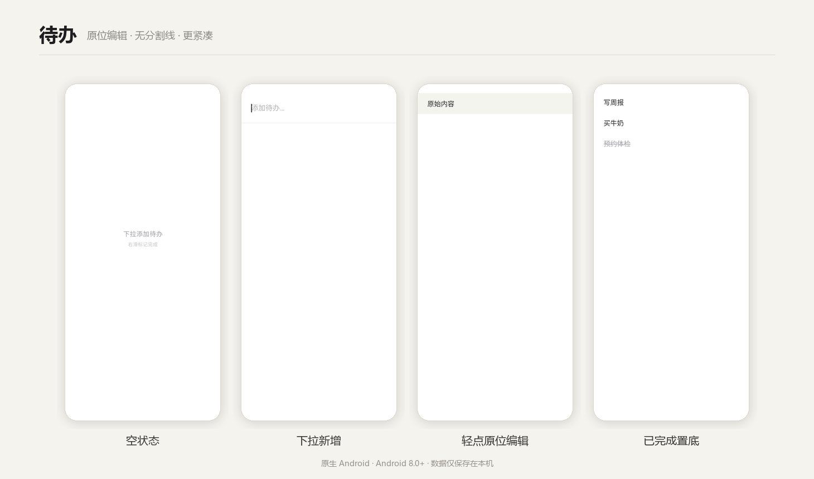

# 待办 · 极简清单

一个只保留内容的 Android 待办清单。下拉输入、右滑完成；完成项自动移到底部，文字变灰并加上删除线。

> GitHub：[joah9806/liubai-todo](https://github.com/joah9806/liubai-todo) · 发布版本：[Releases](https://github.com/joah9806/liubai-todo/releases)



## 交互

- **下拉新增**：在列表顶部向下拉，松手后出现输入栏；输入内容后按键盘「完成 / 回车」。
- **右滑完成**：把未完成的一条向右滑，松手后标记为已完成。滑动时只有轻微的浅绿底色和勾选提示。
- **已完成置底**：完成项会移到所有未完成项之后；新完成的项目追加到最底部。
- **已完成样式**：文字灰色，并在文字中间加删除线。
- **分隔线**：每条待办之间有一条细横线，最后一条没有尾部横线。
- **极简界面**：没有标题栏、按钮、勾选框、分类或设置。可以点按空白状态提示打开输入框。
- **自动保存**：数据仅保存在本机，重新打开应用不会丢失。

在输入状态点击输入栏以外的地方、按返回键，会保存当前文字并收起输入栏；输入为空时直接收起。

## 安装

- APK：在 [Releases](https://github.com/joah9806/liubai-todo/releases/latest) 下载 `todo-1.0.apk`
- 支持系统：Android 8.0（API 26）及以上
- 包名：`com.liubai.todo`
- 版本：1.0（versionCode 1）
- SHA-256：`3edb63615fc74b5198fd16d96219b1b027e8da595e28326ce0d09968dae2062a`
- APK 校验文件：[`todo-1.0.apk.sha256`](https://github.com/joah9806/liubai-todo/releases/download/v1.0.0/todo-1.0.apk.sha256)

安装方式：将 APK 发送到手机，在文件管理器中打开；如果系统提示，请允许「安装未知应用」，然后安装。

## 界面细节

完整截图在 [`preview/`](preview)：

| 状态 | 截图 |
| --- | --- |
| 空状态 |  |
| 列表 |  |
| 右滑中 |  |
| 下拉输入 |  |
| 已完成置底 |  |

视觉参数：纯白背景、17sp 正文、26dp 左右内边距、极细灰色分隔线；已完成使用 `#A2A2A7` 灰色和删除线。所有截图来自真实 View 渲染，不是手绘稿。

## 实现

- 原生 Android（Java），单 Activity，无 AndroidX/第三方运行时依赖。
- `PullToAddLayout`：处理列表顶部的下拉手势、输入栏展开/收起和键盘。
- `TodoRowView`：每行自绘，处理右滑手势、浅绿反馈、勾选动画、分隔线和完成样式。
- `TodoStore`：使用 `SharedPreferences` + JSON 持久化，无网络权限、无账号、无统计。
- 完成项按完成时间保持顺序；加载时会自动把未完成项排在前面、完成项放在底部。
- 已做 Android 8.0 到 Android 15 的窗口边到边适配：状态栏/导航栏为白色背景配深色图标，并处理刘海屏和输入法 Insets。

## 项目结构

```
todo-app/
├─ app/src/main/java/com/liubai/todo/   # 应用源码
├─ app/src/main/res/                     # 图标、主题、文案
├─ app/src/test/java/com/liubai/todo/    # Robolectric UI/交互测试
├─ release/                              # 发布用 APK 和 SHA-256（供 Actions 上传）
├─ .github/workflows/                    # Release 资产上传工作流
├─ dist/                                 # 本地构建输出（Git 忽略）
├─ preview/                              # 实际渲染截图
├─ build.ps1 / build.cmd                 # 无 Gradle 的签名构建脚本
├─ gradlew / gradlew.bat                 # Gradle 8.9 wrapper
└─ README.md
```

## 构建

### 直接构建签名 APK（Windows）

需要：

- JDK 17
- Android SDK Platform 35、Build-Tools 35.0.0
- 设置环境变量 `JAVA_HOME`、`ANDROID_SDK_ROOT`（未设置时会尝试本机默认工具链路径）

在项目目录运行：

```powershell
.\build.cmd
```

或：

```powershell
powershell -NoProfile -ExecutionPolicy Bypass -File .\build.ps1
```

输出：`dist/todo-1.0.apk`，并自动写入 SHA-256 文件。该脚本使用 `aapt2` + `javac` + `d8` + `apksigner`，不依赖 Gradle。

首次构建时，如果本地还没有签名密钥，脚本会在被 Git 忽略的 `keystore/` 目录中生成一个新的 keystore 和随机密码；也可以通过环境变量 `TODO_KEYSTORE_PASS` 指定已有密钥的密码。

### 使用 Android Studio / Gradle

```powershell
.\gradlew.bat :app:assembleDebug
```

命令行构建前需要设置 `ANDROID_HOME` 或 `ANDROID_SDK_ROOT`（或创建本机的 `local.properties`）；Android Studio 会自动完成这一步。调试包会输出到 `app/build/outputs/apk/debug/`。

## 测试

```powershell
.\gradlew.bat :app:testDebugUnitTest
```

测试使用 Robolectric 4.14.1，共 4 项，全部通过：

- API 30 下拉手势打开输入栏并成功添加待办；
- API 30 右滑完成后自动置底、灰色 + 删除线、数据持久化及重启恢复；
- API 30 空状态截图；
- API 26 最低版本启动与添加待办冒烟测试。

测试会同时生成 `app/build/screenshots/` 下的界面截图。

## 签名

v1.0.0 发布包使用本地发布密钥签名，证书 SHA-256：`EDD059D5815AA63A34C65F6DA5ED76BE425DB4A133D2AB016B49CEE17944D0B2`。

签名密钥与密码不会提交到源码仓库。自行构建时，`build.ps1` 会在本地 `keystore/` 目录生成新密钥和随机密码；若使用已有密钥，可通过 `TODO_KEYSTORE_PASS` 提供密码。公开上架前建议使用自己的发布签名配置。

## 说明

界面刻意不做删除、编辑、分类、提醒和设置；如果后续需要这些能力，可以在现有 `TodoStore` 和单行 View 的基础上扩展。清除应用数据或卸载应用会清空待办。
